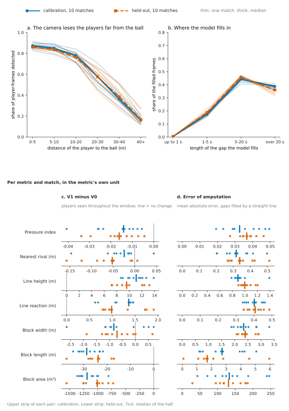
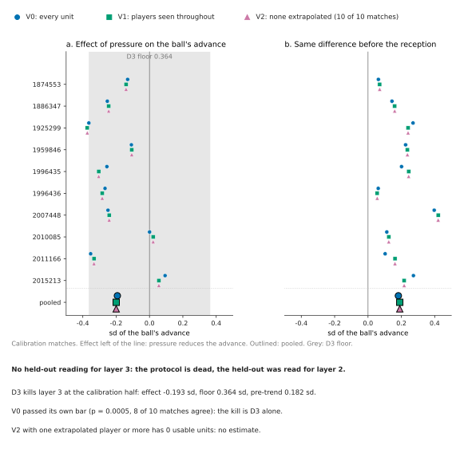

# What the camera saw: defensive metrics from broadcast tracking

SkillCorner marks each player-frame as detected or extrapolated. In the 20 A-League 2024/25 matches of the Analytics Cup 2.0 the camera saw about half: a per-match median of 56.2% (10 calibration matches) and 57.0% (10 held out). Per match I recompute each defensive metric on the units the camera saw whole, and show the "extrapolated" positions are interpolated: filled with the next detection in hand.

For analysts: block length and area are mostly what the camera chose to show, line height and reaction follow it, pressure and nearest rival survive; tag every metric with how many of its players were seen. All were seen, per-match median, in 2.4% of phases for the block (3.3% held-out) and 33% of receptions for the four-man line (36%).

Layer 1 is ingestion (`ftbase`). Layer 2 measures what the camera saw: each player-frame carries `is_detected`, I add `gap_len` (frames to the nearest detection), and seven metrics (local pressure, nearest rival, line height, its reaction to the incoming ball, block width, length, area) are computed three ways: V0 on every unit as listed; V1 only on units whose players were all seen; V2 split by how many of them were seen. A unit is a reception (pressure, rival, line) or a defensive phase (block). Layer 3 asks one question. The split came first; the held-out was read once, after the code froze. Amputation error: hide seen players as the camera does, fill with a straight line, remeasure.



*Figure 1, per match: (a) detection by ball distance, (b) filled frames by gap length, (c) V1 minus V0, (d) amputation error.*

## Layer 2

**Extrapolated is interpolated.** A predictor's error grows with the gap, so a re-detection would jump. It does not. After a gap over 20 s a player reappears a median 0.203 m from its filled position (p90 0.43, p99 0.63), against 0.198 m (0.45, 0.67) for a detected-to-detected step, in calibration; held-out, 0.190 m (0.41, 0.66) against 0.201 m (0.45, 0.68). Gaps over 20 s hold 38.7% and 36.0% of the filled frames (Figure 1b). kloppy 3.19.1 drops `is_detected` on SkillCorner tracking (`docs/kloppy_issue_draft.md`).

**Sensitivity (n = 10 matches per half).** V1 minus V0 measures selection, not fill error: the camera follows the ball (Figure 1a), so fully seen units are the ones near the ball. Seen-only line height is +7.2 to +13.2 m higher in the held-out (+8.7 to +13.9 m in calibration), block length -37.3 to -17.1 m (-34.5 to -21.8 m), in every match of both halves, as is the sign of area, reaction and pressure; nearest rival in 9 of 10, width mixed (narrower in 8 and 7 of 10). Filling costs little: a straight line through a gap is off by 0.79 to 1.39 m on line height over both halves (Figure 1d), against +7 to +14 m of selection; the reference is the units seen whole, few and compact for the block, and the error grows with the gap (`reports/amputation.csv`, `gt_20s`). Selection is the problem: a metric that needs the far players is mostly model.

## Layer 3: killed as designed

The pre-registered kill rule (`protocol/protocol.json`, committed before any outcome) fired in calibration: the published result. Does pressure on the receiver reduce the ball's advance over the next 1.3 s, within incoming-ball strata? The pooled effect is -0.19 sd, negative in 8 of 10 matches, permutation p = 0.0005: it passes the bar. It dies on D3: pressed receptions already had a more forward incoming ball than free ones, by 0.18 sd, 95% of the effect, above the 50% limit; the effect is adjusted for that difference, the rule kills it anyway, and its floor, 0.36 sd, was known before any outcome (`reports/design.json`). Seen-only players change nothing (-0.20 sd): gaps do not explain it. The held-out never opened for it (stage `dead`).



*Figure 2. (a) Effect per calibration match, -0.36 to +0.09 sd; grey band, the D3 floor, 0.36 sd. (b) The pre-reception difference, 0.18 sd.*

## Reproduce

Needs [uv](https://docs.astral.sh/uv/), git, Python 3.13 or later, plus ffmpeg (`ac2fb clip`, tests); run on Windows and GitHub's Linux runners, untested on macOS. Quick (one match, 5 files, 95.6 MB, about 9 s on a GitHub runner, packages cached):

<!-- clean-clone:quick:start -->
```bash
git clone https://github.com/javiersr1996/ac2-football
cd ac2-football
uv sync --locked
uv run ftbase ingest --match 1874553
uv run ftbase bronze && uv run ftbase silver && uv run ac2fb layer2 --match 1874553 --reports-dir ../reports-quick
```
<!-- clean-clone:quick:end -->

Full (85 files, 1.9 GB, 1.8 GB of it Git LFS, about 3.5 min on a GitHub runner, data cached; mind SkillCorner's quota):

<!-- clean-clone:full:start -->
```bash
git clone https://github.com/javiersr1996/ac2-football
cd ac2-football
uv sync --locked
uv run ftbase ingest
uv run ftbase bronze && uv run ftbase silver && uv run ac2fb layer2 && uv run ac2fb reliability && uv run ac2fb amputation && uv run ac2fb calibration
```
<!-- clean-clone:full:end -->

Every command has `--check`; `ac2fb figures` redraws them. The held-out opens only inside `ac2fb heldout read`, at the reading commit (`docs/heldout.md` has the commands `full-build.yml` runs); it reproduced byte for byte on my Windows machine; on Linux one player-frame crosses a band edge, pinned in `scripts/heldout_linux_diff.txt`.

## Provenance

Ingestion and the conformed data come from [`ftbase`](https://github.com/javiersr1996/football-tracking-base), my open-source (MIT) pipeline for SkillCorner data, pinned at tag `v0.1.0` (commit `53080bc`) and extracted in October 2026 from my private repository *tracklab* (its `docs/provenance.md` lists every file). tracklab measured the proportion of detected rows; everything here was written for the Cup.

## Reuse

`ac2fb layer2`, `ac2fb reliability` and `ac2fb amputation` take `--match ID` for the 10 calibration matches (the door refuses the rest). On other SkillCorner data, build the three silver tables in `ftbase`'s shape and call the public steps `examples/sensitivity.py` runs on a synthetic match; `ac2fb.reliability` lists them.

## License and data

Code: MIT (`LICENSE.md`). Data: SkillCorner's, downloaded by the commands above, not redistributed. Synthetic fixtures are used only for tests and produce no figure in this README.
